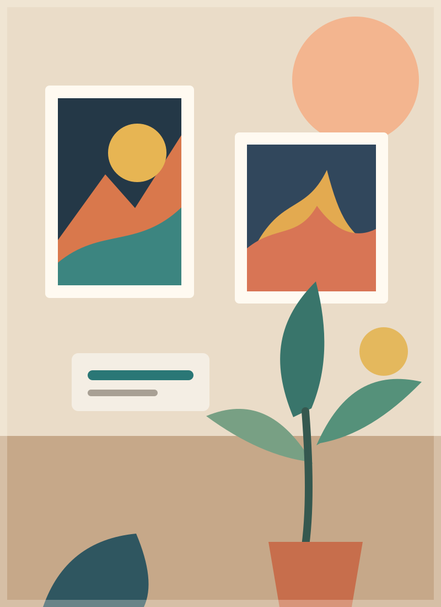

<!-- _class: cover -->
<!-- _paginate: false -->

# Art Gallery

### An artist portfolio application

**Presented by Badreddine Hammam**

 

---

<!-- _class: agenda -->

# Presentation plan

1. Project idea
2. Technical stack
3. Key data concepts
4. The need
5. Proposed solution and practice
6. Expected results

---

# Technical stack

## What we know

| Project part | Information |
|---|---|
| Application type | Art Gallery / Portfolio App |
| Main data entities | Artist, Artwork, ArtMedium |
| Project owner | Badreddine Hammam |

## To be confirmed

The programming language, framework, database, and development tools were not included in the project information.

*Add the real technologies here when they are confirmed.*

---

# Key concepts

| Concept | Simple meaning |
|---|---|
| **Artist** | A person who creates art. |
| **Artwork** | A creative piece, such as a painting or sculpture. |
| **ArtMedium** | The material or method used to make an artwork, such as oil paint. |
| **Portfolio** | A selected collection of an artist's work. |

**Example:** An artist's portfolio can show an artwork and the medium used to create it.

---

# The need

## The challenge

Artists and visitors need a clear way to find and understand creative work.

## The goal

Build a portfolio application that brings artist profiles, artworks, and art mediums together.

- Keep art information organized.
- Show who created each artwork.
- Describe the medium used for each piece.
- Make the collection easier to explore.

---

# Proposed solution and practice

## Three connected data entities

**Artist** → creates → **Artwork** → uses → **ArtMedium**

### Suggested development steps

1. Define the information stored for each entity.
2. Confirm how artists, artworks, and mediums are related.
3. Build the application with the chosen technology stack.
4. Add sample records and check that they display correctly.

*These relationships and steps are a proposal; confirm them against the final design.*

---

<!-- _class: conclusion -->

# Expected results

- Artist information can be organized.
- Artworks can be presented as a portfolio.
- Each artwork can show its art medium.
- The project owner is **Badreddine Hammam**.

## Next steps

Confirm the technology stack, finalize the data relationships, and add real application screenshots.

### Thank you

**Questions?**
